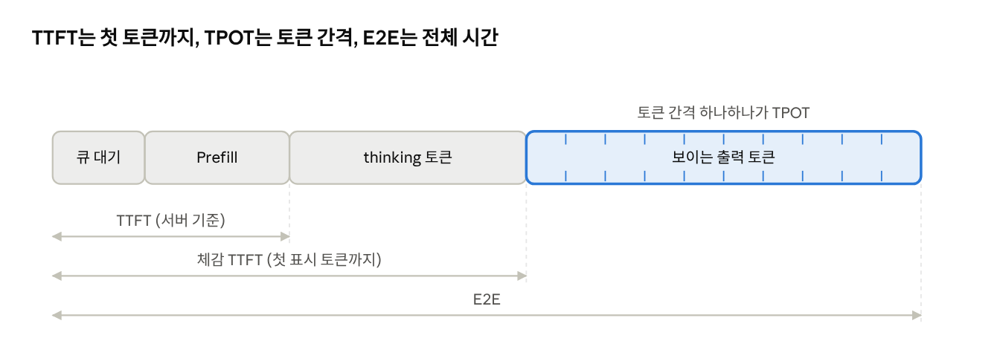
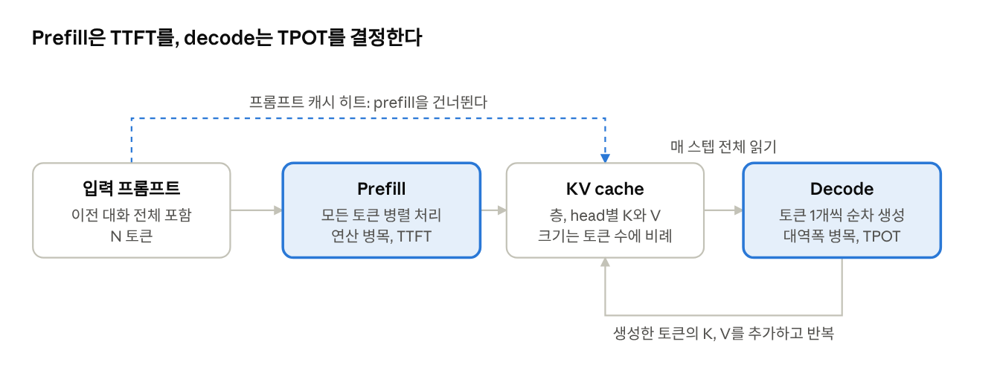
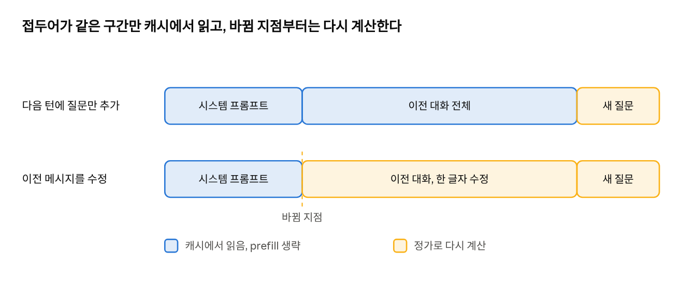
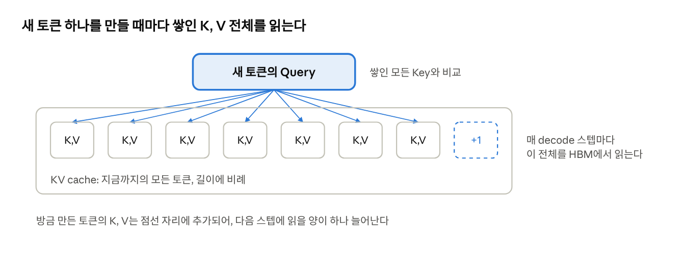
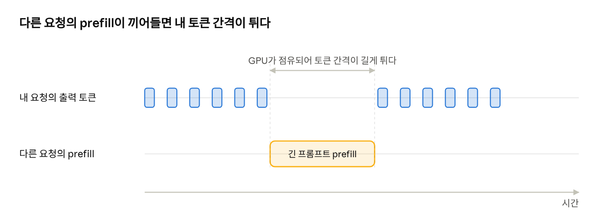

# LLM 추론 Latency 영향 요소 정리

작성일: 2026년 10월 27일

> 이 문서는 Claude Docs에서 작성한 원본을 마크다운으로 내보낸 것이다. 원본: https://claude.ai/artifact/A5N7WJYmSUphjkXGMN4k2T

## 범위와 전제

같은 모델을 같은 서버 환경에서 돌릴 때도 요청마다 latency가 달라지는 이유는, 입력과 출력의 길이, 캐시 상태, 그 순간의 서버 부하라는 세 축에서 나온다. 이 문서는 그 세 축에 속하는 요소만 다루고, 애플리케이션 코드의 처리 시간과 외부 툴 호출의 왕복 시간은 제외한다.

측정 지표는 아래 세 가지로 나누어 본다. 요소마다 영향을 주는 지표가 다르기 때문에 하나로 합쳐서 재면 원인을 구분할 수 없다.

| 지표 | 뜻 | 주로 결정하는 단계 |
| --- | --- | --- |
| TTFT (Time To First Token) | 요청을 보낸 뒤 첫 출력 토큰이 도착할 때까지의 시간 | prefill + 큐 대기 |
| TPOT (Time Per Output Token) 또는 ITL | 출력 토큰 사이의 평균 간격 | decode |
| E2E (End-to-End) | 요청부터 마지막 토큰까지의 전체 시간. 대략 TTFT + TPOT × 출력 토큰 수 | 양쪽 모두 |



요청 하나는 큐 대기, prefill, thinking, 보이는 출력 순으로 진행되고, 세 지표는 이 흐름의 서로 다른 구간을 재므로 하나가 나빠지면 어느 구간이 원인인지 가릴 수 있다.

이 문서의 단가와 캐시 동작은 2026년 10월 27일에 확인한 Anthropic 공식 문서를 기준으로 하며, 출처는 문서 끝에 적었다.

## 추론의 두 단계: prefill과 decode

한 번의 생성 요청은 성격이 완전히 다른 두 단계로 처리되고, 각 단계의 병목이 다르기 때문에 같은 요소라도 TTFT와 TPOT에 다르게 작용한다.

**Prefill**은 시스템 프롬프트와 이전 대화를 포함한 입력 전체를 한 번에 통과시켜 모든 입력 토큰의 Key와 Value를 계산하고 KV cache에 채우는 단계다. 토큰들이 병렬로 처리되므로 행렬 곱이 크고, GPU 연산량이 병목이 된다. 이 단계가 끝나야 첫 토큰이 나오므로 TTFT를 결정한다.

**Decode**는 토큰 하나를 만들고, 그 토큰의 K와 V를 캐시에 덧붙이고, 다시 다음 토큰을 만드는 반복이다. 매 스텝의 연산은 토큰 하나 분량뿐이지만, 모델 가중치 전체와 KV cache 전체를 GPU 메모리(HBM)에서 연산 유닛으로 읽어 내려야 한다. 그래서 스텝당 시간은 연산 속도가 아니라 메모리 대역폭이 결정하며, 이것이 TPOT다.

```latex
TPOT \approx \frac{\text{weights bytes} + \text{KV cache bytes}}{\text{HBM bandwidth}}
```

이 식에서 가중치 항은 모델이 고정되면 상수이고, KV cache 항만 요청마다 달라진다. 즉 같은 모델과 서버에서 TPOT를 움직이는 것은 사실상 컨텍스트 길이와, 같은 GPU를 나눠 쓰는 다른 요청들이다.



캐시 히트가 나면 점선 경로로 prefill을 건너뛰어 TTFT가 줄지만, decode 루프는 그대로이므로 TPOT는 컨텍스트 길이에 따라 결정된다.

## 입력 측 요소: 컨텍스트 길이와 캐시 히트

TTFT를 가장 크게 움직이는 것은 이번 요청에서 새로 prefill 해야 하는 토큰 수다. 보낸 컨텍스트 전체가 아니라, 그중 캐시에 없는 부분이 기준이다.

**컨텍스트 길이.** 시스템 프롬프트, 이전 대화, 첨부 문서, 도구 정의가 모두 입력 토큰이다. 캐시가 없으면 prefill 연산이 이 길이에 거의 비례해서 늘고, attention 항은 길이의 제곱에 가깝게 늘어난다. 멀티턴 대화는 턴이 쌓일수록 매번 보내는 컨텍스트가 길어지므로, 같은 질문이라도 뒤로 갈수록 TTFT가 길어진다.

**프롬프트 캐시 히트.** 요청의 앞부분이 이전 요청과 토큰 단위로 정확히 일치하면 그 구간의 KV cache를 재사용해 prefill을 건너뛴다. 이 경우 새로 계산하는 것은 일치가 끝난 지점 이후의 토큰뿐이라, 10만 토큰 대화에 한 줄 질문을 덧붙여도 TTFT는 짧은 프롬프트 수준으로 내려간다. Claude API에서는 요청에 cache\_control 표시를 넣거나 자동 캐싱을 켜야 동작하고, 응답의 usage.cache\_read\_input\_tokens로 히트 여부를 확인할 수 있다.



질문만 덧붙이면 새 질문 구간만 계산하지만, 중간 메시지를 한 글자라도 바꾸면 그 지점부터 끝까지 전부 다시 계산한다.

캐시가 깨지면 그 지점 이후 전체를 정가로 다시 prefill 한다. 깨지는 조건은 아래와 같다.

| 캐시가 깨지는 조건 | 설명 |
| --- | --- |
| TTL 만료 | 기본 5분, 옵션으로 1시간. 읽기마다 타이머가 무료로 갱신되지만, 수명은 요청 시작 시점부터 재므로 4분짜리 생성이 끝나면 약 1분만 남는다 |
| 접두어 불일치 | 시스템 프롬프트에 현재 시각이나 요청 ID 같은 가변 값이 들어가면 첫 토큰부터 어긋난다 |
| 이전 메시지 수정 | 대화 중간을 편집하거나 삭제하면 그 지점 이후가 무효가 된다 |
| 도구 목록 변경 | 렌더링 순서가 tools, system, messages이므로 도구 정의가 바뀜면 그 뒤가 전부 무효가 된다 |
| 모델 또는 옵션 변경 | 캐시는 모델 단위로 분리되며, effort나 속도 옵션을 바꾸면 메시지 캐시가 무효가 된다 |
| 최소 길이 미달 | 최신 모델은 512 토큰, 구형 모델은 최대 4096 토큰 미만이면 오류 없이 캐시되지 않는다 |
| 동시 요청 | 캐시는 첫 응답이 스트리밍을 시작한 뒤에야 읽을 수 있으므로, 같은 접두어를 동시에 보내면 모두 정가로 처리된다 |

## 출력 측 요소: 출력 토큰 수와 thinking

E2E latency에서 가장 큰 몶을 차지하는 것은 대개 출력 토큰 수다. Decode는 토큰을 하나씩 순차로 만들기 때문에 병렬화로 줄일 수 없고, 출력이 두 배면 생성 시간도 거의 두 배가 된다.

**보이는 출력뿐 아니라 thinking도 출력이다.** 현재 Claude 모델은 응답 전에 내부 추론 토큰을 생성하며, 이 토큰은 표시 여부와 관계없이 똑같이 decode 스텝을 소모한다. 사용자에게는 첫 표시 토큰까지의 긴 공백으로 보이므로, 실제 TTFT와 체감 TTFT를 구분해서 재야 한다. Fable 5.1과 Opus 5.5는 thinking을 끄지 못하고, 깊이는 output\_config.effort로만 조절한다.

**Effort 수준.** low부터 max까지의 단계가 thinking 길이와 전체 토큰 소비를 함께 움직인다. 같은 질문이라도 effort가 높으면 생성이 길어지므로, latency 비교 실험에서는 effort를 고정해야 한다. 대화 도중에 최상위 effort를 바꾸면 메시지 캐시까지 무효가 되므로 TTFT도 함께 늘어난다.

**max\_tokens 자체는 속도에 영향이 없다.** 이 값은 상한일 뿐이고, 모델은 그 값을 알지 못한 채 생성한다. 다만 상한에 걸리면 응답이 잘리고 재요청이 필요해져 결과적으로 더 느려진다.

**응답 형식.** 구조화 출력이나 장황한 지시는 모델이 만드는 토큰 수를 바꾸므로, 단가가 같아도 응답 길이를 통해 latency에 간접적으로 영향을 준다.

## 컨텍스트 길이가 decode 속도에 미치는 영향

캐시가 완벽하게 맞아 prefill을 전부 건너뛰어도, 컨텍스트가 길면 토큰 하나를 만드는 시간이 느려진다. KV cache는 재계산을 없애 줄 뿐, 읽는 비용을 없애 주지는 않기 때문이다.

Decode 매 스텝마다 새 토큰의 Query를 지금까지 쌓인 모든 Key와 비교해야 하므로, 캐시 전체를 HBM에서 한 번씩 읽는다. 이 읽기는 출력 토큰마다 반복된다. 컨텍스트가 10만 토큰이면 매 스텝 10만 토큰분의 K, V를 읽고, 그 양은 아래 식으로 컨텍스트 길이에 정비례한다.



새 토큰은 자기 Query 하나만 계산하지만 비교 대상은 쌓인 토큰 전부이므로, 읽어야 하는 양은 컨텍스트 길이에 따라 늘고 스텝마다 하나씩 더 늘어난다.

```latex
\text{KV bytes per token} = 2 \times L \times H_{kv} \times d_{head} \times \text{bytes}
```

여기서 L은 층 수, H는 KV head 수, d는 head 차원이다. 예를 들어 Llama 2 7B는 fp16 기준 토큰당 약 0.5 MB여서 4k 컨텍스트에 약 2 GB를 차지한다. 가중치가 수십 GB라면 짧은 컨텍스트에서는 캐시 항이 무시할 만하지만, 수십만 토큰에서는 가중치와 같은 규모가 되어 TPOT이 눈에 띄게 늘어난다.

이 영향은 세 가지 형태로 나타난다.

- **한 응답 안에서** 뒤쪽 토큰이 앞쪽 토큰보다 조금씩 느려진다. 생성된 토큰도 캐시에 덧붙기 때문이다.
- **턴이 쌓일수록** 같은 길이의 답변이라도 더 오래 걸린다. 캐시 히트는 TTFT를 지켜 주지만 TPOT는 지켜 주지 못한다.
- **서버 메모리 점유.** 긴 컨텍스트 요청은 KV 메모리를 많이 차지해 같은 GPU에 동시에 올릴 수 있는 요청 수를 줄이고, 그 결과 다음 절의 큐 대기에도 영향을 준다.

과금도 같은 구조를 따른다. 캐시 읽기는 기본 입력가의 0.1배, Opus 5.5와 Sonnet 5.5는 0.05배, Fable 5.1은 0.025배로 할인되지만 0이 아니며, 그 이유가 바로 이 읽기 비용과 메모리 점유다.

## 서버 측 동적 요소: 동시 요청과 스케줄링

같은 하드웨어라도 그 순간 GPU를 나눠 쓰는 다른 요청들이 내 요청의 latency를 바꾼다. 사용자가 핵제할 수 없는 변동의 대부분이 여기서 나온다.

**큐 대기.** 서버가 받을 수 있는 동시 요청 수는 KV cache 메모리로 제한되므로, 그 한도를 넘으면 요청이 큐에서 기다린다. 이 시간은 고스란히 TTFT에 더해지고, 모델 연산과는 무관하므로 TTFT만 튀는 형태로 관측된다.

**Batching.** 현대 서빙 엔진은 continuous batching으로 여러 요청의 decode 스텝을 한 번에 처리한다. 가중치를 한 번 읽어 여러 요청에 쓰므로 처리량은 올라가지만, 배치가 커질수록 스텝당 읽어야 하는 KV cache 합계가 늘어 개별 요청의 TPOT은 느려진다. 한가한 시간대와 붐비는 시간대의 TPOT 차이는 대부분 이 효과다.

**Prefill과 decode의 간섭.** 한 GPU가 내 요청의 decode를 돌리는 도중 다른 요청의 긴 prefill이 들어오면, 연산 집약적인 prefill이 GPU를 점유하는 동안 내 토큰 생성이 멈췄다. 이것이 토큰 간격이 간헐적으로 길게 튀는 현상의 주요 원인이다. 엔진은 chunked prefill이나 prefill 전용 장비 분리로 이를 완화하지만 완전히 없애지는 않는다.



같은 GPU를 쓰는 다른 요청의 prefill이 들어오는 순간 내 토큰 생성이 멈추므로, 평균 TPOT는 정상이어도 특정 토큰 간격만 길게 튀는 모양으로 관측된다.

**KV 메모리 압박과 캐시 퇴출.** 메모리가 부족하면 엔진은 보관 중인 프롬프트 캐시를 먼저 버리고, 더 부족하면 실행 중인 요청을 중단했다가 다시 시작하기도 한다. 트래픽이 많을 때 TTL 안에 보낸 요청이 캐시 미스를 내는 이유가 이것이다.

**라우팅.** 복제본이 여러 개인 배포에서 프롬프트 캐시는 그것을 만든 장비에만 있다. 다음 요청이 다른 장비로 가면 캐시가 있어도 미스가 나며, 서비스가 캐시 위치를 고려해 라우팅하는지에 따라 히트율이 달라진다.

**Rate limit.** 할당량을 넘으면 429 응답과 재시도 대기가 생긴다. Claude API에서 캐시 읽기 토큰은 대부분의 모델에서 입력 토큰 rate limit에 산입되지 않으므로, 캐시 히트는 이 대기를 줄이는 효과도 있다.

## 요청 옵션이 latency에 주는 영향

모델과 서버를 바꾸지 않고도 요청 옵션만으로 latency의 특정 구간을 줄일 수 있다. 각 옵션이 어느 지표를 건드는지가 다르므로 목적에 맞춰 골라야 한다.

| 옵션 | 영향 지표 | 효과와 조건 |
| --- | --- | --- |
| Streaming | 체감 TTFT | 첫 토큰을 즉시 보여 준다. 생성 속도 자체는 같지만, 긴 출력에서 HTTP 타임아웃을 피하는 유일한 방법이다 |
| 프롬프트 캐싱 | TTFT | 접두어가 일치하는 구간의 prefill을 건너뛴다. 안정적인 내용을 앞에, 가변 내용을 마지막 breakpoint 뒤에 둔다 |
| 캐시 keep-alive | TTFT | 유휴 중에 max\_tokens 0으로 같은 요청을 다시 보내 TTL을 갱신한다. 출력 토큰 없이 캐시 읽기 단가만 든다 |
| 1시간 TTL | TTFT | 요청 간격이 5분을 넘고 1시간 안일 때만 이득이다. 쓰기 단가가 2배로 오른다 |
| Effort 낮춤 | TPOT × 토큰 수 | thinking 길이가 줄어 전체 생성 시간이 줄어든다. 품질과의 교환이므로 경로별로 측정 후 정한다 |
| Fast mode | TPOT | Opus 5.5와 Opus 5에서 출력 속도를 최대 2.5배까지 높인다. 단가가 2배이고 별도 rate limit을 따른다 |
| Priority tier | 큐 대기 | 혼잡 시 우선 처리를 보장한다. Fable 5.1, Opus 5.5, Sonnet 5.5 등 일부 모델은 지원하지 않는다 |
| Compaction | TTFT, TPOT | 오래된 대화를 서버가 요약해 컨텍스트 자체를 줄인다. 컨텍스트 길이에 비례하는 모든 항을 함께 줄인다 |
| Context editing | TTFT, TPOT | 지난 도구 결과나 thinking 블록을 비워 컨텍스트를 줄인다. 요약이 아니라 삭제다 |
| Batch API | 해당 없음 | 비동기 처리라 latency를 보장하지 않는다. 실시간이 필요 없는 작업을 옮겨 실시간 경로의 부하를 덬다 |

Compaction과 context editing은 긴 대화에서 가장 효과가 크다. 프롬프트 캐싱이 재계산만 피하는 반면, 이 두 가지는 매 decode 스텝에서 읽어야 하는 KV cache 양 자체를 줄이기 때문이다. 다만 기존 메시지를 바꾸는 동작이므로 그 턴에는 캐시가 한 번 깨진다.

## 측정 시 권장 사항

Latency를 조사할 때는 하나의 전체 시간이 아니라 지표를 나눠 기록해야 원인을 가를 수 있다. 위의 요소들은 갅기 다른 지표에 나타나기 때문이다.

- [ ] TTFT와 TPOT를 따로 재고, TPOT는 평균뿐 아니라 분포를 본다. 간헐적인 긴 간격은 평균에 묻히지만 prefill 간섭의 증거다.
- [ ] 모든 응답의 usage 필드를 기록한다. input\_tokens, cache\_read\_input\_tokens, cache\_creation\_input\_tokens, output\_tokens가 있어야 어떤 요청이 캐시 미스였는지, 출력이 야마나 길었는지 사후에 가를 수 있다.
- [ ] 비교 실험에서는 컨텍스트 길이, effort, max\_tokens, 시스템 프롬프트를 고정한다. 하나만 바꾸고 나머지는 똑같이 둔다.
- [ ] 캐시를 데운 상태와 식은 상태를 구분해 측정한다. 첫 요청은 항상 쓰기이므로 버리거나 따로 표기한다.
- [ ] 같은 요청을 시간대를 바꾸어 반복한다. 서버 부하에 의한 변동은 이 방법으로만 분리된다.
- [ ] thinking이 켜진 모델에서는 첫 바이트 도착과 첫 표시 토큰 도착을 따로 재서, 서버 TTFT와 사용자 체감 TTFT를 구분한다.
- [ ] 캐시 히트율이 낮으면 요청을 바이트 단위로 비교해 접두어가 어디서 갈리는지 찾는다. 시각, 정렬되지 않은 JSON, 바뀜는 도구 목록이 흔한 원인이다.

## 요약 표

같은 모델과 서버에서 latency를 움직이는 요소를 영향 지표와 사용자 통제 가능 여부로 정리하면 아래와 같다.

| 요소 | TTFT | TPOT | 통제 | 비고 |
| --- | --- | --- | --- | --- |
| 캐시되지 않은 입력 토큰 수 | 크게 증가 | 없음 | 사용자 | prefill 연산에 비례 |
| 전체 컨텍스트 길이 | 캐시 미스 시 증가 | 증가 | 사용자 | 매 스텝 KV cache 읽기에 비례 |
| 프롬프트 캐시 히트 | 크게 감소 | 없음 | 사용자 | 접두어 일치, TTL 5분 또는 1시간 |
| 출력 토큰 수 | 없음 | 없음 | 부분적 | E2E는 TPOT × 토큰 수로 증가 |
| thinking 길이, effort | 체감 TTFT 증가 | 없음 | 사용자 | 보이지 않는 출력 토큰 |
| 큐 대기 | 증가 | 없음 | 서버 | KV 메모리 한도와 동시 요청 수 |
| 배치 크기 | 없음 | 증가 | 서버 | 혼잡 시간대에 느려짐 |
| 다른 요청의 prefill 간섭 | 없음 | 간헐적 증가 | 서버 | 토큰 간격이 튜는 현상 |
| KV 메모리 압박 | 캐시 퇴출 시 증가 | 없음 | 서버 | TTL 안에도 미스 가능 |
| 라우팅 | 미스 시 증가 | 없음 | 서버 | 캐시는 만든 장비에만 존재 |
| Streaming | 체감 감소 | 없음 | 사용자 | 실제 생성 속도는 동일 |
| Fast mode | 없음 | 감소 | 사용자 | Opus 5.5, Opus 5 한정, 단가 2배 |
| Compaction, context editing | 감소 | 감소 | 사용자 | 컨텍스트 자체를 줄임 |

## 출처

- [Anthropic Pricing](https://platform.claude.com/docs/en/about-claude/pricing), 2026년 10월 27일 확인
- [Prompt caching](https://platform.claude.com/docs/en/build-with-claude/prompt-caching), 2026년 10월 27일 확인
- Fast mode, priority tier, compaction, context editing 관련 사항은 Claude Code에 내장된 claude-api 스킬 문서(2026년 10월 6일 기준 스냅샷)를 참고했다
- Prefill, decode, KV cache 설명은 transformer 추론 구조에 대한 일반 지식이며, Llama 2 7B의 캐시 크기는 공개된 모델 구조로 계산한 근사치다
